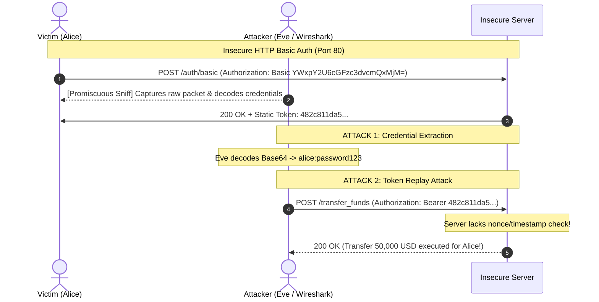
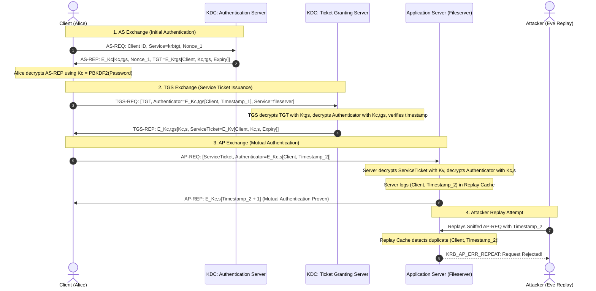
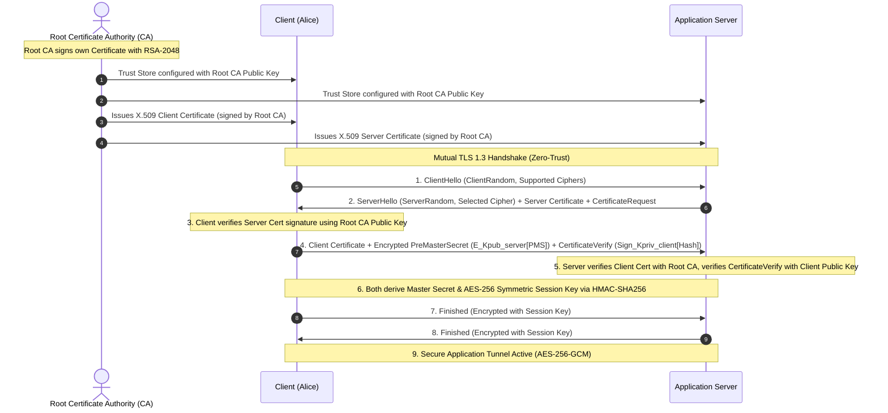

# System Architecture & Cryptographic Specifications

## 1. Weak Authentication Attack Flow

---

## 2. Kerberos v5 (RFC 4120) Protocol Architecture

---

## 3. Public Key Infrastructure (PKI) & Mutual TLS (mTLS) Architecture

